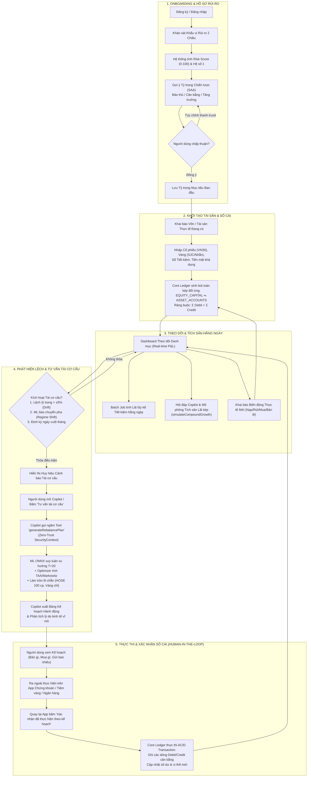

# ĐẶC TẢ TOÀN DIỆN LUỒNG NGƯỜI DÙNG (USER FLOW SPECIFICATION)

## HỆ THỐNG THEO DÕI DANH MỤC VÀ CỐ VẤN TÀI CHÍNH CÁ NHÂN (ROBO-ADVISOR & PORTFOLIO TRACKER)

---

## MỤC LỤC

1. [Triết lý Trải nghiệm &amp; Tác nhân Hệ thống](#1-triết-lý-trải-nghiệm--tác-nhân-hệ-thống)
2. [Sơ đồ Luồng Tổng thể (End-to-End Workflows)](#2-sơ-đồ-luồng-tổng-thể-end-to-end-workflows)
   * 2.1. Sơ đồ Trạng thái Toàn trình (Flowchart)
   * 2.2. Sơ đồ Tuần tự Tương tác (Sequence Diagram)
3. [Đặc tả Chi tiết 6 Giai đoạn Trong Hành trình Người dùng](#3-đặc-tả-chi-tiết-6-giai-đoạn-trong-hành-trình-người-dùng)
   * 3.1. Giai đoạn 1: Onboarding & Khảo sát Khẩu vị Rủi ro (Risk Profiling & SAA)
   * 3.2. Giai đoạn 2: Khai báo Danh mục Khởi tạo & Sổ cái Kép (Portfolio Ingestion)
   * 3.3. Giai đoạn 3: Theo dõi Thường nhật, Định giá P&L & Mô phỏng Lãi kép
   * 3.4. Giai đoạn 4: Cảnh báo Tái cơ cấu & Cố vấn Tài chính (Copilot Rebalance Advisory)
   * 3.5. Giai đoạn 5: Thực thi Ngoài Đời & Xác nhận Sổ cái (Human-in-the-Loop)
   * 3.6. Giai đoạn 6: Quản lý Đáo hạn Tiết kiệm & Tự động Hóa Lãi kép
4. [Bảng Ma trận Màn hình &amp; Tương tác UI/UX](#4-bảng-ma-trận-màn-hình--tương-tác-uiux)
5. [Các Kịch bản Minh họa Thực tế (Use Case Walkthroughs)](#5-các-kịch-bản-minh-họa-thực-tế-use-case-walkthroughs)
   * 5.1. Kịch bản 1: Thị trường chuyển Risk-Off (Phòng thủ & Tích lũy Vàng/Tiết kiệm)
   * 5.2. Kịch bản 2: Tái tục Lãi kép Sổ Tiết kiệm tự động
6. [Xử lý Ngoại lệ và Tình huống Biên (Edge Cases)](#6-xử-lý-ngoại-lệ-và-tình-huống-biên-edge-cases)

---

## 1. Triết lý Trải nghiệm & Tác nhân Hệ thống

### 1.1. Triết lý Cốt lõi

Hệ thống **không phải là sàn giao dịch** và **không trực tiếp giữ tiền thật** của người dùng. Hệ thống đóng vai trò:

1. **Sổ cái tài chính cá nhân chuẩn mực (Double-Entry Ledger):** Quản lý tài sản minh bạch, không sai lệch tiền tệ, lưu vết dòng vốn theo chuẩn kế toán.
2. **Hệ thống cố vấn thông minh (Robo-Advisor):** Kết hợp mô hình Machine Learning dự báo xu hướng trung hạn với lý thuyết tối ưu hóa danh mục đầu tư (Markowitz & TAA).
3. **Trợ lý AI đàm thoại an toàn (Zero-Trust Financial Copilot):** Phân tích và đưa ra kế hoạch hành động dễ hiểu, tuân thủ nguyên tắc **Human-in-the-Loop** (Người dùng toàn quyền quyết định và thực hiện ngoài đời thực trước khi chốt dữ liệu vào sổ cái).

### 1.2. Các Tác nhân Tham gia Luồng (Actors)

* **Nhà đầu tư (Investor - Người dùng cuối):** Khai báo tài sản, xem báo cáo, nhận tư vấn từ Copilot, thực hiện giao dịch thực tế ngoài đời và xác nhận cập nhật sổ cái.
* **Financial Copilot (Spring AI Agent):** Trò chuyện tự nhiên, giải thích ngữ cảnh kinh tế vĩ mô, gọi công cụ tính toán kế hoạch tái cơ cấu và mô phỏng tích sản.
* **Core Ledger Engine (Java & PostgreSQL):** Đảm bảo tính toán toàn vẹn ACID, quản lý tài khoản và các bút toán kép $\sum \text{Debit} - \sum \text{Credit} = 0$.
* **ML Inference Engine (LightGBM qua ONNX Runtime):** Suy luận dự báo nhãn xu hướng chu kỳ $T+20$ phiên (Cổ phiếu VN30 & Vàng thế giới/SJC) trong bộ nhớ JVM dưới $5\text{ ms}$.
* **Portfolio Optimizer (Thuật toán Java):** Tính toán tỷ trọng chiến thuật (TAA), áp dụng mô hình Markowitz MVO và làm tròn theo bước nhảy thực tế (lô 100 cổ phiếu HOSE, chỉ vàng).
* **Batch Worker (Spring Batch):** Chạy ngầm hàng ngày tính lãi lũy kế cho sổ tiết kiệm, xử lý đáo hạn tự động và đối soát toàn vẹn sổ cái.

---

## 2. Sơ đồ Luồng Tổng thể (End-to-End Workflows)

### 2.1. Sơ đồ Trạng thái Toàn trình (Flowchart)



---

### 2.2. Sơ đồ Tuần tự Tương tác (Sequence Diagram - Luồng Tái Cơ Cấu)

```mermaid
sequenceDiagram
    autonumber
    actor User as Nhà đầu tư
    participant Web as Web Dashboard
    participant Copilot as Financial Copilot (Spring AI)
    participant Opt as Portfolio Optimizer
    participant ML as ML Inference (ONNX)
    participant Ledger as Core Ledger Service
    participant DB as PostgreSQL Database
    actor RealWorld as Ứng dụng Ngoài Đời (TCBS, Ngân hàng, Tiệm vàng)

    User->>Web: Nhấp "Xem đề xuất Tái cơ cấu"
    Web->>Copilot: Gửi yêu cầu tư vấn tái cơ cấu
    Note over Copilot: Trích xuất Authentication an toàn (Zero-Trust)
    Copilot->>Opt: Gọi Tool generateRebalancePlan()
    Opt->>Ledger: Lấy số dư và danh mục hiện tại
    Ledger->>DB: Truy vấn Accounts, Holdings & Savings
    DB-->>Ledger: Trả về dữ liệu tài sản
    Opt->>ML: Yêu cầu dự báo xu hướng T+20 (Cổ phiếu & Vàng)
    ML-->>Opt: Trả về nhãn (ví dụ: Stock=-1, Gold=+1) & Confidence (80%)
    Note over Opt: Tính ma trận TAA + Markowitz MVO<br/>+ Làm tròn lô chẵn 100 cp & chỉ vàng
    Opt-->>Copilot: Trả về Structured JSON Plan
    Copilot-->>Web: Trả về Bảng Kế hoạch Hành động + Lời giải thích tự nhiên
    Web-->>User: Hiển thị Bảng kế hoạch (Bán HPG, Mua Vàng SJC, Gửi Tiết kiệm)

    User->>RealWorld: Tự thao tác đặt lệnh bán cổ phiếu & mua vàng ngoài thực tế
    RealWorld-->>User: Giao dịch thực tế hoàn tất

    User->>Web: Nhấp "Xác nhận đã thực hiện theo kế hoạch"
    Web->>Ledger: Gửi lệnh ghi nhận thực thi tái cơ cấu
    Note over Ledger: Mở ACID Transaction: Kiểm tra Σ Debit = Σ Credit
    Ledger->>DB: Ghi Transaction & Entries, cập nhật Holdings & Savings
    DB-->>Ledger: Commit thành công
    Ledger-->>Web: Phản hồi hoàn tất (200 OK)
    Web-->>User: Cập nhật Dashboard tỷ trọng cân bằng mới, xóa cảnh báo lệch
```

---

## 3. Đặc tả Chi tiết 6 Giai đoạn Trong Hành trình Người dùng

### 3.1. Giai đoạn 1: Onboarding & Khảo sát Khẩu vị Rủi ro (FR-1)

* **Bước 1: Xác thực:** Người dùng đăng ký/đăng nhập hệ thống (hỗ trợ JWT/OAuth2).
* **Bước 2: Khảo sát Khẩu vị Rủi ro:**
  * Hệ thống cung cấp bộ câu hỏi trắc nghiệm đa chiều:
    * *Năng lực tài chính:* Thu nhập bình quân, tính ổn định của dòng tiền, tỷ lệ nợ, thời gian dự kiến nắm giữ.
    * *Tâm lý chịu rủi ro:* Phản ứng trước biến động (VD: "Nếu danh mục giảm 15% trong 1 tháng, bạn sẽ: A. Bán tháo cắt lỗ, B. Giữ nguyên, C. Mua thêm tích sản").
* **Bước 3: Định lượng Toán học:**
  * Hệ thống tính toán điểm số tổng hợp $\text{Risk Score} \in [0, 100]$.
  * Tự động ánh xạ sang **Hệ số ngại rủi ro ($\lambda$)**:
    $$
    \lambda = \lambda_{\max} - \left(\frac{\text{Risk Score}}{100}\right) \times (\lambda_{\max} - \lambda_{\min})
    $$

    *(Với $\lambda_{\min} = 1.0$ cho nhóm Mạo hiểm và $\lambda_{\max} = 10.0$ cho nhóm Bảo thủ).*
* **Bước 4: Đề xuất Tỷ trọng Chiến lược (Strategic Asset Allocation - SAA):**
  * *Nhóm Bảo thủ ($\lambda \ge 7.0$):* 15% Cổ phiếu – 25% Vàng – 60% Tiết kiệm/Tiền mặt.
  * *Nhóm Cân bằng ($4.0 \le \lambda < 7.0$):* 35% Cổ phiếu – 35% Vàng – 30% Tiết kiệm/Tiền mặt.
  * *Nhóm Tăng trưởng ($\lambda < 4.0$):* 60% Cổ phiếu – 20% Vàng – 20% Tiết kiệm/Tiền mặt.
* **Bước 5: Người dùng Xác nhận / Điều chỉnh:**
  * Người dùng có thể kéo thanh trượt điều chỉnh tỷ trọng theo ý muốn cá nhân (Ràng buộc: Tổng tỷ trọng $= 100\%$).
  * Nhấn **"Lưu hồ sơ đầu tư"** để hoàn tất khởi tạo.

---

### 3.2. Giai đoạn 2: Khai báo Danh mục Khởi tạo & Sổ cái Kép (FR-2 & Thiết kế 2)

Do người dùng đã tích lũy tài sản từ trước khi sử dụng ứng dụng, hệ thống áp dụng nguyên tắc **Khai báo Vốn chủ sở hữu (Equity Injection)**:

1. **Giao diện Khai báo Tài sản:**
   * **Cổ phiếu VN30:** Người dùng nhập mã cổ phiếu (`HPG`, `TCB`, `FPT`), số lượng đã mua (bội số của 100), giá vốn mua bình quân ($P_{entry}$), ngày giao dịch trong quá khứ.
   * **Vàng vật chất:** Chọn loại (`GOLD_SJC` hoặc `GOLD_RING_9999`), số lượng (Chỉ hoặc Lượng), giá mua tại thời điểm giao dịch.
   * **Sổ tiền gửi Tiết kiệm:** Chọn ngân hàng (`VCB`, `MBB`...), số tiền gửi gốc ($P$), lãi suất (%/năm), kỳ hạn (1, 3, 6, 12 tháng), ngày gửi và bật/tắt tùy chọn `auto_rollover` (Tự động tái tục lãi kép).
   * **Tiền mặt khả dụng:** Nhập số dư tiền mặt nhàn rỗi đang có (`VND_WALLET`).
2. **Cơ chế Xử lý ngầm của Core Ledger:**
   * Hệ thống tự động tạo giao dịch loại `CAPITAL_INJECTION`.
   * Ghi nhận bút toán kép đối ứng nguồn vốn `EQUITY_CAPITAL`:
     * **Nợ (Debit):** Tài khoản tài sản tương ứng (`STOCK_{SYMBOL}`, `GOLD_{TYPE}`, `SAVINGS_{ID}`, `VND_WALLET`).
     * **Có (Credit):** Tài khoản vốn `EQUITY_CAPITAL`.
   * Bất biến kế toán: $\sum \text{Debit} - \sum \text{Credit} = 0$.

---

### 3.3. Giai đoạn 3: Theo dõi Thường nhật, Định giá P&L & Mô phỏng Lãi kép (FR-2, FR-6)

1. **Dashboard Thời gian thực (Portfolio Tracking):**
   * Hiển thị **Tổng giá trị tài sản ròng (Total Net Worth)** theo thị giá mới nhất:
     $$
     V_{total} = \text{Balance}_{VND} + \sum (Q_s \times P_s^{market}) + (Q_{gold} \times P_{gold}^{market}) + \sum (P_{savings} + \text{AccruedInterest})
     $$
   * Biểu đồ tỷ trọng cơ cấu thực tế so với mục tiêu ban đầu.
   * Tỷ suất sinh lời P&L (lãi/lỗ danh nghĩa và phần trăm sinh lời của từng lớp tài sản).
2. **Tính Lãi lũy kế Hàng ngày (Daily Accrued Interest):**
   * Định kỳ 00:00 hàng ngày, Batch Job tính lãi lũy kế tạm tính:
     $$
     \text{AccruedInterest} = P \times \frac{r}{365} \times \text{Số ngày gửi}
     $$
   * Giúp người dùng theo dõi giá trị sinh sôi của tiền gửi mỗi ngày mà không cần chờ đến ngày đáo hạn hợp đồng.
3. **Mô phỏng Tích sản cùng Copilot (Wealth Projection):**
   * Người dùng nhắn tin trong khung chat: *"Nếu mỗi tháng tôi tích lũy thêm 10 triệu đồng gửi tiết kiệm 6%/năm thì sau 5 năm tôi có bao nhiêu tiền?"*.
   * Copilot tự động kích hoạt Tool `simulateCompoundGrowth(initialAmount, monthlyContribution, interestRate, years)`.
   * Copilot xuất biểu đồ và số liệu phân tích: Tổng tiền gốc tích lũy được so với số tiền lãi kép thặng dư sinh ra.
4. **Khai báo Biến động Thực tế:**
   * Khi người dùng nạp thêm vốn, rút tiền tiêu dùng, hoặc tự mua/bán thêm tài sản ngoài đời, người dùng vào mục "Khai báo giao dịch" để sổ cái luôn phản ánh đúng thực tế.

---

### 3.4. Giai đoạn 4: Cảnh báo Tái cơ cấu & Cố vấn Tài chính (FR-4, FR-5, FR-6)

1. **Cơ chế Phát hiện Lệch (Drift & Regime Shift Triggers):**
   * Cảnh báo tự động xuất hiện khi thỏa mãn ít nhất 1 trong 3 điều kiện:
     * **Lệch tỷ trọng tự nhiên:** Tồn tại lớp tài sản có $|w_i^{current} - w_i^{target}| \ge 5\%$.
     * **Chuyển đổi trạng thái thị trường (Regime Shift):** Mô hình Machine Learning phát hiện đảo chiều (VD: Cổ phiếu chuyển sang *Risk-Off* / Vàng chuyển sang *Bullish*).
     * **Định kỳ hàng tháng:** Ngày cuối tháng hệ thống kích hoạt chu kỳ rà soát định kỳ.
2. **Tương tác với Financial Copilot:**
   * Người dùng nhấp vào thông báo cảnh báo trên Dashboard hoặc chat: *"Hãy phân tích danh mục và đề xuất kế hoạch tái cơ cấu"*.
3. **Quy trình Xử lý Ngầm (Deterministic Execution & Zero-Trust):**
   * Copilot gọi Tool Java `@Tool RebalancePlan generateRebalancePlan()`.
   * Danh tính người dùng được trích xuất an toàn từ `SecurityContextHolder` (chặn đứng tấn công IDOR).
   * **Module Học máy (ONNX):** Thực thi mô hình LightGBM suy luận nhãn xu hướng $T+20$ cho Cổ phiếu và Vàng kèm điểm tin cậy $P_{confidence}$.
   * **Module Tối ưu hóa (Portfolio Optimizer):**
     * Tính toán dịch chuyển tỷ trọng chiến thuật (TAA Matrix).
     * Xác định lượng giá trị cần điều chỉnh $\Delta V_i$.
     * **Thuật toán làm tròn lô khớp lệnh thực tế:** Cổ phiếu làm tròn bội số 100 cổ phiếu (sàn HOSE), Vàng làm tròn theo chỉ/lượng. Tiền lẻ dôi ra giữ tại ví tiền mặt `VND_WALLET`.
4. **Phản hồi của Copilot:**
   * Xuất **Bảng Kế hoạch Hành động (Action Plan)** rõ ràng từng bước:
     * *Bước 1:* BÁN 2,000 cổ phiếu `HPG` với thị giá $25,000\text{ VND}$ $\rightarrow$ Thu về $50,000,000\text{ VND}$.
     * *Bước 2:* MUA 5 chỉ vàng miếng `GOLD_SJC` với giá $8,000,000\text{ VND/chỉ}$ $\rightarrow$ Chi $40,000,000\text{ VND}$.
     * *Bước 3:* MỞ sổ tiết kiệm kỳ hạn 6 tháng tại Vietcombank $\rightarrow$ Gửi $10,000,000\text{ VND}$.
   * Lời giải thích chuyên gia: Phân tích lý do vì sao thị trường cổ phiếu đang rủi ro, tại sao nên trú ẩn vào vàng và tiết kiệm để bảo vệ thành quả đầu tư.

---

### 3.5. Giai đoạnáca5: Thực thi Ngoài Đời & Xác nhận Sổ cái (FR-6.4 & Thiết kế 5)

Nhằm đảm bảo nguyên tắc **Human-in-the-Loop**, AI không bao giờ tự ý thao tác cơ sở dữ liệu khi chưa có sự phê duyệt của người dùng:

1. **Người dùng Thao tác Ngoài Đời Thực:**
   * Người dùng mở ứng dụng công ty chứng khoán (TCBS, SSI, VPS...) đặt lệnh bán 2,000 HPG.
   * Người dùng đến tiệm vàng/ngân hàng mua 5 chỉ vàng SJC.
   * Người dùng mở app Mobile Banking mở một sổ tiết kiệm online 10 triệu đồng.
2. **Xác nhận trong Ứng dụng:**
   * Người dùng quay lại giao diện đề xuất của Copilot.
   * Bấm nút **"Xác nhận đã thực hiện theo kế hoạch"**.
   * *(Trường hợp ngoài đời khớp lệnh có chênh lệch giá hoặc khối lượng, người dùng bấm "Chỉnh sửa số liệu thực tế" trước khi bấm Xác nhận).*
3. **Thực thi Bút toán Kép (ACID Commit):**
   * Core Ledger mở một Transaction duy nhất trong cơ sở dữ liệu:
     * Tạo mã giao dịch `REBALANCE`.
     * Ghi nhận các bút toán kép `entries`:
       * Credit `STOCK_HPG`: $-50,000,000\text{ VND}$ | Debit `VND_WALLET`: $+50,000,000\text{ VND}$.
       * Credit `VND_WALLET`: $-40,000,000\text{ VND}$ | Debit `GOLD_SJC`: $+40,000,000\text{ VND}$.
       * Credit `VND_WALLET`: $-10,000,000\text{ VND}$ | Debit `SAVINGS_VCB`: $+10,000,000\text{ VND}$.
     * Cập nhật bảng vị thế `asset_holdings` (giảm 2,000 HPG, tăng 5 chỉ SJC).
     * Tạo bản ghi mới trong `savings_deposits` (VCB, 10 triệu, kỳ hạn 6 tháng).
   * Hoàn tất transaction: Tỷ trọng danh mục được đưa về trạng thái tối ưu, thông báo cảnh báo biến mất.

---

### 3.6. Giai đoạn 6: Quản lý Đáo hạn Tiết kiệm & Tự động Hóa Lãi kép (FR-2.5)

1. **Theo dõi Tự động:** Người dùng không cần ghi nhớ lịch đáo hạn thủ công.
2. **Quy trình Xử lý khi Đáo hạn (`maturity_date`):**
   * Batch Job của hệ thống quét các hợp đồng tiết kiệm đến hạn vào lúc 00:05 hàng ngày.
   * **Nếu `auto_rollover = true` (Bật Lãi kép):**
     * Hệ thống tính tiền lãi thực tế của kỳ hạn:
       $$
       I_{maturity} = P \times \frac{r}{360} \times \text{Số ngày thực gửi}
       $$
     * Tự động tạo bút toán kép nhập lãi vào gốc:
       * Debit `SAVINGS_DEPOSIT`: $+I_{maturity}$.
       * Credit `INTEREST_INCOME`: $-I_{maturity}$.
     * Cập nhật số tiền gốc mới: $P_{new} = P + I_{maturity}$ và gia hạn thêm một kỳ hạn tương đương.
     * Bắn thông báo UI: *"Sổ tiết kiệm [Tên Ngân hàng] đã tự động tái tục thành công kèm lãi kép"*.
   * **Nếu `auto_rollover = false`:**
     * Chuyển toàn bộ tiền gốc và lãi về ví tiền mặt khả dụng `VND_WALLET`.

---

## 4. Bảng Ma trận Màn hình & Tương tác UI/UX

| Tên Màn hình / Modal                  | Mục đích                     | Dữ liệu Nhập vào (Input)                                                                    | Phản hồi của Hệ thống (Output)                                                                            | Hành động Kế tiếp                                                         |
| :--------------------------------------- | :------------------------------ | :---------------------------------------------------------------------------------------------- | :------------------------------------------------------------------------------------------------------------- | :----------------------------------------------------------------------------- |
| **Màn hình Khảo sát Rủi ro**  | Thu thập khẩu vị rủi ro     | Trả lời trắc nghiệm tài chính & tâm lý                                                  | Điểm Risk Score, Hệ số$\lambda$, Khuyến nghị SAA (Bảo thủ / Cân bằng / Tăng trưởng)             | Chấp thuận hoặc kéo thanh trượt điều chỉnh                            |
| **Màn hình Khai báo Tài sản** | Khởi tạo tài sản đã có   | Mã cổ phiếu, khối lượng, giá mua; Loại vàng, chỉ/lượng; Sổ tiết kiệm; Tiền mặt | Core Ledger sinh bút toán kép đối ứng`EQUITY_CAPITAL`. Kiểm tra $\sum Debit = \sum Credit$          | Chuyển đến Dashboard chính                                                 |
| **Dashboard Tổng quan**           | Theo dõi tài sản hàng ngày | Không                                                                                          | Tổng tài sản ròng, Biểu đồ tỷ trọng thực tế vs mục tiêu, Lãi lũy kế tiết kiệm, P&L chi tiết | Xem chi tiết hoặc mở khung chat Copilot                                     |
| **Khung Chat Copilot**             | Trợ lý tư vấn & giải đáp | Câu hỏi tự nhiên (VD: "Mô phỏng lãi kép", "Thị trường thế nào?")                   | Spring AI kích hoạt Tool tương ứng, trả lời phân tích chuyên gia kèm biểu đồ                     | Hỏi tiếp hoặc yêu cầu lập kế hoạch tái cơ cấu                       |
| **Modal Kế hoạch Tái cơ cấu** | Xem đề xuất mua/bán         | Bấm nút "Tái cơ cấu ngay" từ cảnh báo                                                   | Bảng Action Plan chi tiết (Mã, Hành động, Khối lượng đã làm tròn lô, Giá trị VND)              | Đi thực hiện ngoài đời$\rightarrow$ Bấm "Xác nhận đã thực hiện" |
| **Modal Xác nhận Khớp lệnh**   | Chốt sổ cái kép             | Tùy chọn chỉnh sửa số lượng thực tế nếu có sai lệch                                 | Thực thi Transaction ACID, cập nhật lại số dư và vị thế danh mục                                     | Quay lại Dashboard với tỷ trọng chuẩn hóa                                |

---

## 5. Các Kịch bản Minh họa Thực tế (Use Case Walkthroughs)

### 5.1. Kịch bản 1: Thị trường chuyển Risk-Off (Phòng thủ & Tích lũy Vàng/Tiết kiệm)

* **Bối cảnh:** Nhà đầu tư A có hồ sơ Cân bằng (Tỷ trọng mục tiêu: 35% Cổ phiếu – 35% Vàng – 30% Tiết kiệm). Danh mục hiện tại trị giá 200 triệu đồng, trong đó cổ phiếu HPG tăng mạnh đẩy tỷ trọng Cổ phiếu lên 45% (lệch $+10\%$), Vàng chỉ còn 25% (lệch $-10\%$).
* **Diễn biến:**
  1. Mô hình Machine Learning `stock_regime.onnx` dự báo nhãn $-1$ (*Bearish* với độ tin cậy 82%), `gold_trend.onnx` dự báo nhãn $+1$ (*Bullish* với độ tin cậy 75%).
  2. Hệ thống phát hiện cảnh báo kép: Vừa lệch tỷ trọng quá $5\%$, vừa có tín hiệu đảo chiều rủi ro vĩ mô (*Regime Shift*).
  3. UI hiển thị thông báo khẩn: *"Cảnh báo: Danh mục lệch tỷ trọng và thị trường cổ phiếu bước vào pha rủi ro!"*.
  4. Người dùng mở Copilot. Copilot gọi tool `generateRebalancePlan()` và hiển thị đề xuất:
     * **Bán 2,000 cp HPG** (thu về 50 triệu VND).
     * **Mua 5 chỉ vàng SJC** (chi 40 triệu VND).
     * **Mở sổ tiết kiệm 6 tháng** (gửi 10 triệu VND).
  5. Nhà đầu tư A mở app VPS bán 2,000 HPG, ra tiệm vàng mua 5 chỉ SJC, mở app Vietcombank gửi 10 triệu.
  6. Nhà đầu tư A quay lại app bấm **"Xác nhận đã thực hiện theo kế hoạch"**.
  7. Sổ cái kép commit thành công. Tỷ trọng danh mục được tái cân bằng hoàn hảo về vùng an toàn.

---

### 5.2. Kịch bản 2: Tái tục Lãi kép Sổ Tiết kiệm tự động

* **Bối cảnh:** Người dùng B có sổ tiết kiệm 100,000,000 VND tại Techcombank, kỳ hạn 6 tháng, lãi suất 6.0%/năm, tùy chọn `auto_rollover = true`.
* **Diễn biến:**
  1. Trong suốt 6 tháng, hàng ngày Dashboard cộng dồn lãi lũy kế (mỗi ngày khoảng 16,438 VND).
  2. Vào ngày đáo hạn, Batch Job quét sổ tiết kiệm của người dùng B:
     * Tính tiền lãi thực nhận kỳ hạn: $100,000,000 \times 6\% \times \frac{6}{12} = 3,000,000\text{ VND}$.
     * Tự động tạo bút toán kép kết chuyển $3,000,000\text{ VND}$ vào tiền gốc:
       * Nợ `SAVINGS_TCB_01`: $+3,000,000\text{ VND}$.
       * Có `INTEREST_INCOME`: $-3,000,000\text{ VND}$.
     * Cập nhật số tiền gốc mới cho kỳ hạn 6 tháng tiếp theo là $103,000,000\text{ VND}$.
  3. Người dùng B nhận thông báo: *"Sổ tiết kiệm Techcombank của bạn đã tái tục thành công sang kỳ hạn mới với gốc mới 103,000,000 VND nhờ sức mạnh lãi kép!"*.

---

## 6. Xử lý Ngoại lệ và Tình huống Biên (Edge Cases)

| Tình huống Ngoại lệ                                                  | Nguyên nhân phát sinh                                                                                        | Giải pháp Hệ thống & Trải nghiệm Người dùng                                                                                                                                                                     |
| :----------------------------------------------------------------------- | :-------------------------------------------------------------------------------------------------------------- | :----------------------------------------------------------------------------------------------------------------------------------------------------------------------------------------------------------------------- |
| **Khớp lệnh ngoài đời lệch giá/khối lượng**              | Thị giá trượt biên độ hoặc người dùng chỉ mua/bán được một phần                               | Trên Modal xác nhận, người dùng có thể nhấp**"Chỉnh sửa số liệu thực tế"** trước khi bấm Xác nhận. Hệ thống ghi nhận sổ cái theo số liệu thực tế người dùng vừa sửa.             |
| **Tiền lẻ phát sinh do làm tròn lô chẵn**                   | Cổ phiếu bắt buộc lô 100, Vàng theo chỉ$\rightarrow$ Không thể khớp chính xác $100\%$ số tiền | Phần tiền thừa (Residual Cash) tự động lưu giữ tại tài khoản`VND_WALLET` để người dùng sử dụng tích lũy cho lần tái cơ cấu kế tiếp.                                                          |
| **Hai thiết bị cùng gửi yêu cầu giao dịch**                 | Người dùng mở app trên cả điện thoại và máy tính để bấm xác nhận                               | Áp dụng**Optimistic Locking** (`@Version`) trên bảng `accounts`. Giao dịch nào đến sau sẽ bị từ chối và yêu cầu tải lại dữ liệu mới nhất, ngăn chặn tuyệt đối lỗi ghi đè số dư. |
| **Mô hình ML trả về độ tin cậy thấp ($P \approx 0.33$)** | Thị trường đi ngang tích lũy, không rõ xu hướng                                                       | Thuật toán chuẩn hóa tỷ trọng sẽ tự động co độ dịch chuyển$\Delta w_i \rightarrow 0$. Copilot khuyến nghị người dùng giữ nguyên tỷ trọng gốc thay vì giao dịch tốn phí.                    |
| **Người dùng không muốn làm theo Copilot**                   | Người dùng có nhận định cá nhân riêng về thị trường                                               | Người dùng có thể nhấn nút**"Bỏ qua đợt tái cơ cấu này"**. Hệ thống ghi nhận trạng thái từ chối và chỉ cảnh báo lại vào chu kỳ tháng tiếp theo hoặc khi độ lệch phình to hơn.  |

---

*Tài liệu này đóng vai trò là đặc tả chuẩn mực cho việc lập trình giao diện Frontend, triển khai Spring AI Tool Calling, thiết kế API Gateway và kiểm thử trải nghiệm người dùng trong đồ án tốt nghiệp.*
